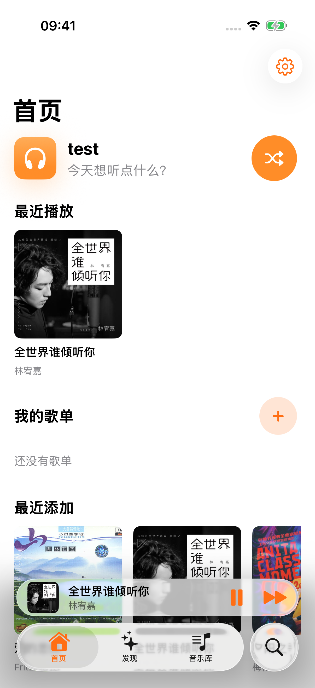
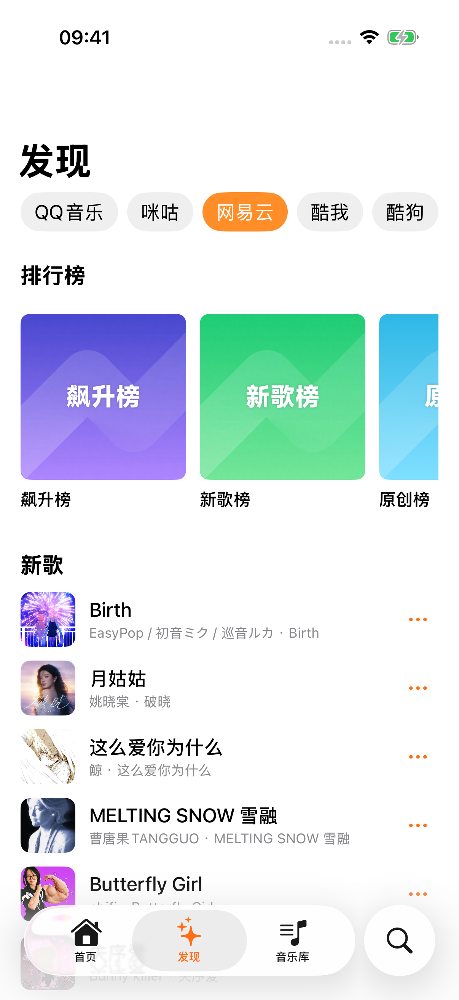
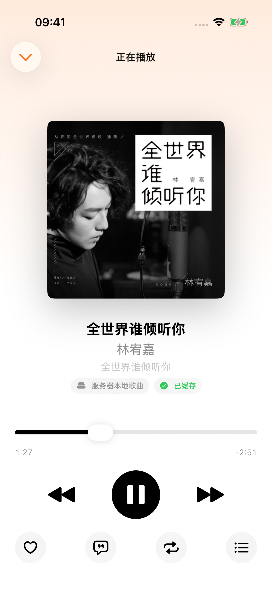

# Lemon Music iOS

柠檬音乐的原生 iPhone 客户端，直接连接 Lemon Music 官方 FPK 提供的 `/api/v1`。

## 界面预览

| 首页 | 在线发现 | 播放器 |
| :---: | :---: | :---: |
|  |  |  |

[查看完整图文展示](docs/SHOWCASE.md)，包含音乐库、榜单详情、歌词、搜索、NAS 下载选项与深色模式。

## 功能

- 本地音乐库：歌曲、专辑、歌手、流派和自定义歌单
- 在线音源：搜索、新歌、推荐歌单和排行榜
- 统一集合详情、列表内搜索、在线歌单收藏与 NAS 同步
- 播放全部、下载到 NAS（320k / FLAC）、后台批量缓存到本机
- 后台播放、锁屏控制、AirPlay、三态播放模式、播放队列和歌词
- SwiftData 元数据缓存与 stale-while-revalidate
- 边播放边写入的断点续传音频缓存，默认 2 GB 空间 LRU
- 单服务器、单账号，Token 仅存储在 Keychain
- 省流模式默认开启：蜂窝下在线音源的新播放和缓存请求使用 128K，关闭后及 Wi-Fi 下读取服务器播放音质设置

本机批量缓存默认仅使用 Wi-Fi，蜂窝流量须单独确认；容量不足时暂停，
可在详情内查看、取消和重试。后台缓存由系统调度，用户强退后需要重新打开应用恢复。
NAS 同名文件、换源及音质待确认任务在服务端网页处理。
已有本机音频缓存直接复用，不重复耗流量；NAS 本地歌曲不转码，仍使用原文件码率。
不同音质的部分缓存和后台续传数据相互隔离，不将 320K 的已下载片段拼到 128K 音频中。
应用重开后的小播放器仅恢复队列信息，首次播放会重新加载缓存或播放链接；加载失败会显示原因和重试入口。
播放诊断可在系统日志中按 `top.btop.music` / `Playback` 过滤，日志不记录鉴权 Token 或完整音频 URL。

## 要求

- iOS 18+
- UI 主要针对 iOS 26 及以上优化，旧版本保留基本兼容
- Xcode 26+
- 已部署并配置音乐库和音源的 Lemon Music 服务端

## 构建

1. 打开 `LemonMusic.xcodeproj`。
2. 在 `LemonMusic` Target 中选择自己的开发团队。
3. 选择 iPhone 或 iOS Simulator，运行 Scheme `LemonMusic`。
4. 首次启动输入服务器地址、用户名和密码。

CarPlay 尚未包含在一期版本中，也不声明 CarPlay entitlement。

## 测试

运行 `LemonMusicTests` 和 `LemonMusicUITests` Scheme。UI 回归使用隔离的样例数据，
不会登录真实服务器。真实登录用例未提供凭据时自动跳过。

后台传输集成测试需要先在另一个终端运行：

```sh
python3 scripts/cache-fixture-server.py
```

该服务只监听本机回环地址，提供测试用 WAV，不访问 NAS。未启动时自动跳过传输集成用例。
模拟器后台会话需要正常签名，不要给这些测试设置 `CODE_SIGNING_ALLOWED=NO`。

## 许可证

本项目基于 Cassette 二次开发，派生文件继续遵循 MPL-2.0。播放器使用本地固定并扩展的 AudioStreaming 1.4.4，其 MIT 许可保留在 `Vendor/AudioStreaming/LICENSE`。其他原始版权及许可信息见 `LICENSE`、`NOTICE` 和 `COPYRIGHT`。
