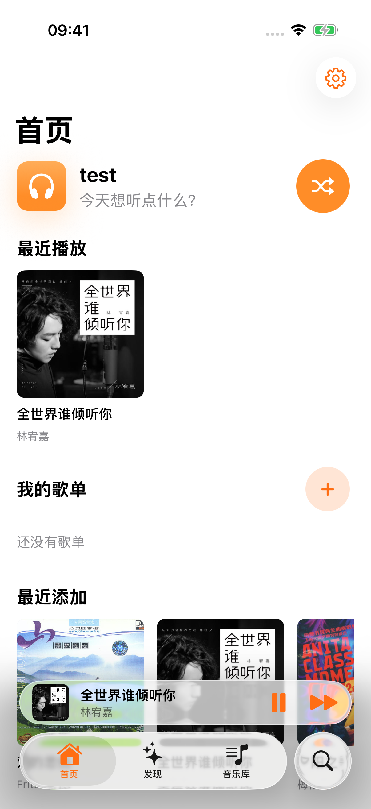
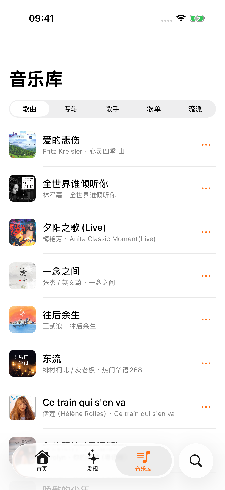
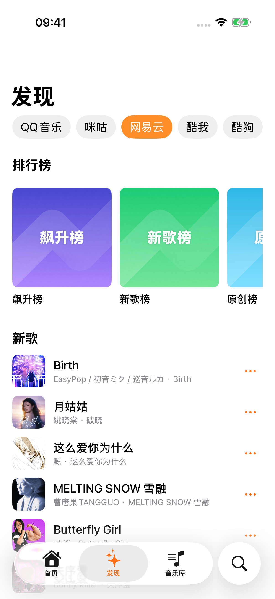
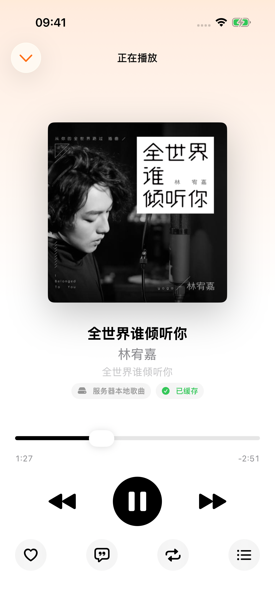
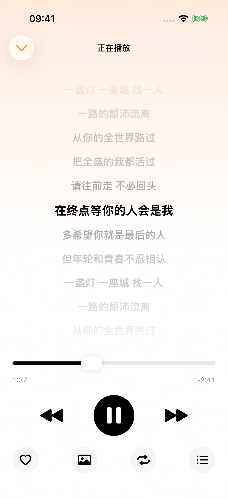
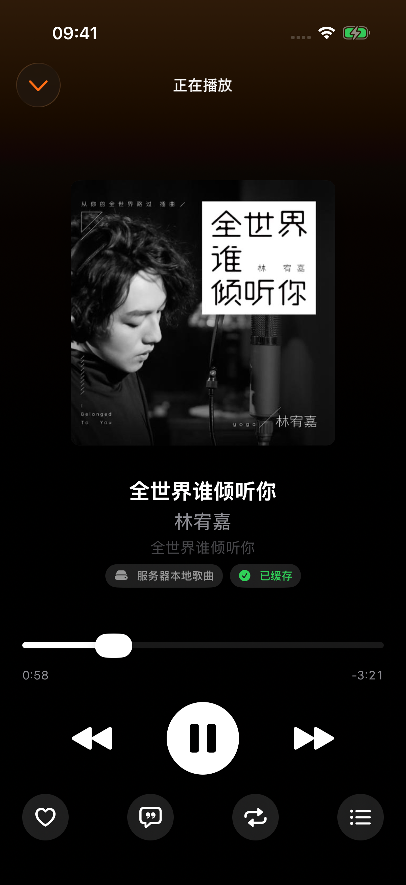

# Lemon Music iOS

柠檬音乐，一款连接 [Lemon Music](https://github.com/jia070310/lemon-muisc) 的原生 iPhone 音乐客户端。支持 iOS 18 及以上版本。

[TestFlight 测试](https://testflight.apple.com/join/gHGkBvKr)

## 功能

- 音乐库：歌曲、专辑、歌手、流派、收藏和歌单。
- 在线音乐：多音源搜索、新歌、排行榜与歌单发现。
- 播放体验：后台播放、锁屏控制、AirPlay、播放队列和同步歌词。
- 缓存与下载：手动缓存、可选的边播边缓存、NAS 下载与 AAC 转码播放。
- CarPlay：最近播放、收藏、歌单和音乐库，以及常用播放控制。
- 小组件：桌面与锁屏歌曲信息展示，桌面播放控制。
- 原生界面：深色模式、系统材质与动态字体。

## 界面预览

| 首页 | 音乐库 | 发现 |
| :---: | :---: | :---: |
|  |  |  |

| 播放器 | 同步歌词 | 深色模式 |
| :---: | :---: | :---: |
|  |  |  |

[更多实际截图](docs/SHOWCASE.md)

## 许可证

本项目基于 Cassette 二次开发，派生文件继续遵循 MPL-2.0。播放器使用本地固定并扩展的 AudioStreaming 1.4.4，其 MIT 许可保留在 `Vendor/AudioStreaming/LICENSE`。其他原始版权及许可信息见 `LICENSE`、`NOTICE` 和 `COPYRIGHT`。
