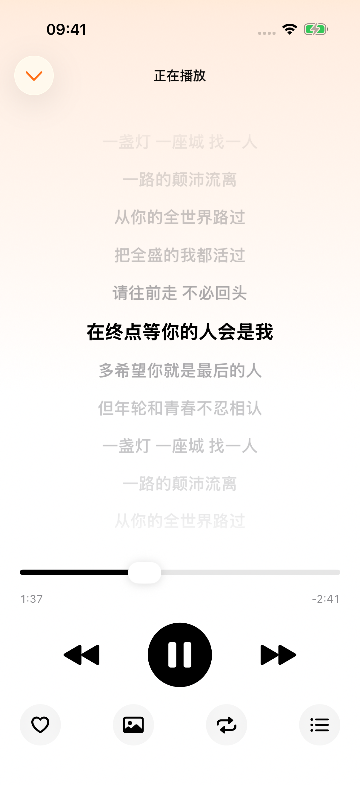
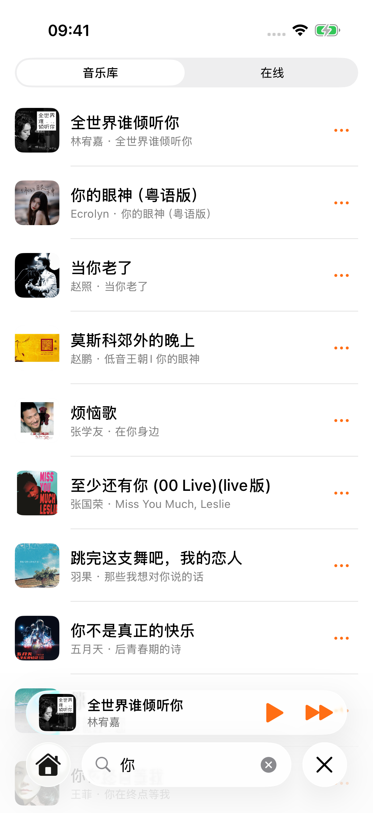
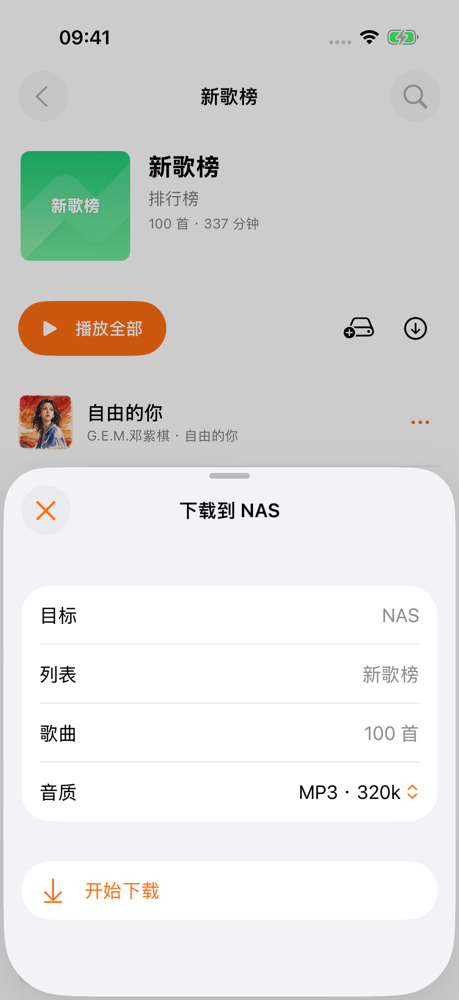
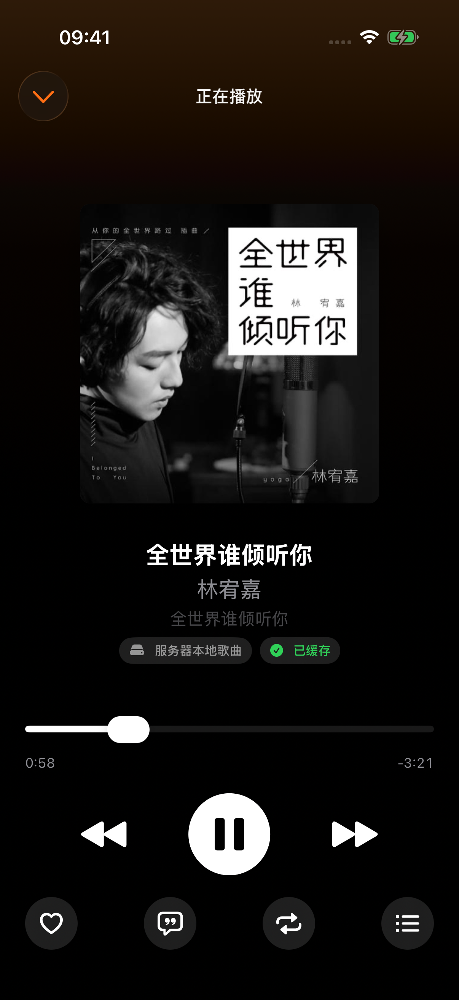
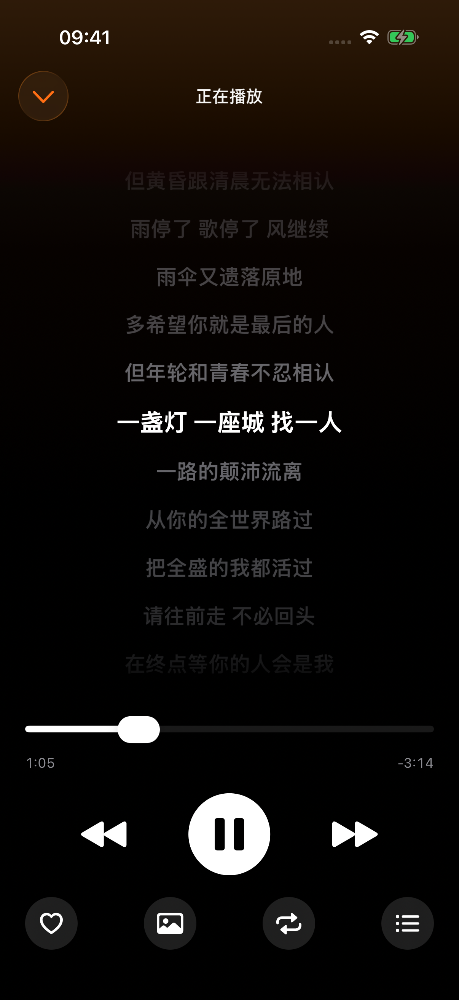

# 柠檬音乐 iOS

你的 NAS 音乐库，随身听。

把个人音乐收藏与在线发现放进同一个原生 iPhone 播放器。以 iOS 26 的系统界面为主，保留 iOS 18 及以上的基本兼容。

## 我的音乐，打开就能听

从最近播放继续聆听，在音乐库中浏览歌曲、专辑、歌手、歌单和流派。

| 首页 | 音乐库 |
| :---: | :---: |
|  |  |

## 发现新音乐，一键播放整张列表

切换服务端已配置的在线音源，浏览排行榜与新歌。集合详情集中展示封面、歌曲数量、时长，以及播放、NAS 下载和本机缓存入口。

| 在线发现 | 榜单详情 |
| :---: | :---: |
|  |  |

## 专注聆听，也专注每一句歌词

大幅封面、清晰的播放控制，以及顺序、随机、单曲循环三种模式。切换歌词后，让进度条上方的空间全部留给歌词。

| 封面播放器 | 沉浸歌词 |
| :---: | :---: |
|  |  |

## 找到想听的，选择想保存的

在音乐库或在线音源中搜索。下载到 NAS 与缓存到本机独立处理；NAS 下载可选择 MP3 320k 或 FLAC，是否可用取决于音源。

| 音乐搜索 | NAS 下载选项 |
| :---: | :---: |
|  |  |

## 深色模式，另一种聆听氛围

封面与歌词页面同时适配深色外观，保留清晰的内容层级和播放控制。

| 深色播放器 | 深色歌词 |
| :---: | :---: |
|  |  |

## 截图说明

- 拍摄日期：2026-10-11。
- 拍摄设备：iPhone 17 Pro 模拟器，iOS 26.0。
- 图片规格：1206 × 2622，原始 PNG 截图；文档中仅缩小显示尺寸。
- 页面连接真实测试服务器，未使用样例数据替换界面；具体内容随音乐库和音源变化。
- NAS 截图只展示下载确认面板，本次拍摄未提交批量下载或批量缓存任务，也未操作收藏。
- 封面、歌词及音乐信息来自测试服务器，仅用于展示客户端界面。

[返回项目介绍](../README.md)
